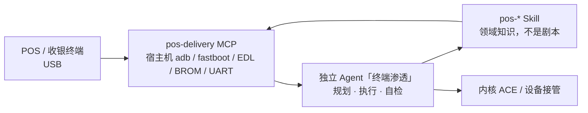

# ARTEX Terminal

**给 ARTEX 装上一个专门打授权 POS / 收银 / 刷卡终端的独立渗透 Agent。**

不 fork Go 源码，不替换你现有的 Web SRC 人格。克隆下来，挂上 Skill，种一个叫「终端渗透」的 Agent，插上 USB 就能开打。

[](#授权与免责)
[](#五分钟上手)
[](#它不做什么)
[](#它是什么)

---

一个人从头打到尾：USB 侦察 → 定攻击面 → 选链深入 → 验证 → 收尾。  
工具给事实，分类器给假设，**路线由 Agent 自己排**。

成功标准只有两个：**可复现的内核代码执行**，或重启后仍在的**设备接管**。  
CVE 命中不是漏洞。体检卡不是完成。内核 ACE 也不是支付密钥 / TEE 被打穿。



## 它是什么

这是 ARTEX 的**二开包**，不是又一个一键 root 脚本。

| 层 | 作用 |
|---|---|
| Agent `terminal` | 原版 ARTEX 六条心法 × 终端。开局看 USB，之后按回包自己排 |
| 八个 `pos-*` Skill | 主控 / USB / PAX / Verifone / MTK / LPE / 接管 / 代码审计 |
| MCP `pos-delivery` | 宿主机执行设备动作。Agent 禁止 Bash 拼 adb/fastboot |
| 双层写入门 | MCP `proposed` + ARTEX 拦截 ASK。不可逆写入必须人批 |

覆盖的链（按现场指纹选，不是默认全跑）：

| 现场 | Skill | 公开问题 / 入口 |
|---|---|---|
| 商米 T69xx / 高通 9008 | `pos-usb-entry` | EDL firehose 读 boot |
| PAX PayDroid + fastboot | `pos-pax-fastboot` | CVE-2023-42134 |
| Verifone VX/MX + 串口 | `pos-verifone-sbi` | CVE-2019-14715 |
| MTK BROM `0e8d:0003` | `pos-mtk-brom` | DA / seccfg |
| 受限 adb shell | `pos-android-lpe` | DirtyCOW / Binder / UVC / GPU |
| 已 uid=0 或可改 boot | `pos-takeover` | Magisk / 持久化 |
| 固件 dump / 厂商 APK | `pos-code-audit` | 事实地图，扫描命中不是洞 |
| 联迪 / Ingenico / 新大陆 | USB + UART + LPE | 无专属 CVE，缺口写明 |

## 它不做什么

- **不内置 exploit 源码。** `payload_deliver` 只传 CVE / stage / target 元数据；实验室服务没配就记缺口，换下一条。
- **不一键 root。** 解锁、刷写、seccfg、SBI overlay 全部 `proposed`。
- **不假装打穿了 TEE。** 没有独立证据就不要写「已拿到卡数据」。
- **不改 ARTEX 源码，** 也不整卷覆盖 `/app/skills`（会盖掉 `api-recon` / `bytesrc`）。

## 五分钟上手

前置：已经在跑的 ARTEX（Docker 或宿主机）、Python 3.10+、宿主机能看到 POS 的 USB（adb / fastboot 在 PATH）。

```bash
git clone https://github.com/csb-12/artex-terminal.git
cd artex-terminal

python -m pip install -r mcp/pos-delivery/requirements.txt
python scripts/bootstrap-terminal-agent.py --init
```

`--init` 会写入 `config/.compose.env`（`ERKA_ROOT` = 本仓库，正斜杠），并打印下一步。然后：

**1. 启动 MCP**（必须跑在插着设备的那台 Windows 宿主机）

```bash
pythonw mcp/pos-delivery/run_http_9911.py
```

或双击 `scripts/launch-http.vbs` / 跑 `scripts/launch-http.ps1`。  
`http://127.0.0.1:9911/health` 应返回 ok。

**2. 把 Skill 挂进 ARTEX 容器**

```bash
docker compose --env-file config/.compose.env -f "%ARTEX_HOME%/docker-compose.yml" -f config/docker-compose.terminal.yml up -d
```

把 `%ARTEX_HOME%` 换成你的 ARTEX 安装目录。只追加八个 `pos-*` 目录，不覆盖原有 Skill。

**3. 种 Agent**

```bash
copy config\artex-auth.example.json config\.artex-auth.json
# 填 ARTEX 登录密码。该文件已被 gitignore。

python scripts/bootstrap-terminal-agent.py --self-check
python scripts/bootstrap-terminal-agent.py
```

聊天页选 **终端渗透**，说：

> 授权 POS，窗口 [起止日期]。设备已插 USB。看清入口后打到内核 ACE 或接管。

Agent 应立刻 `Skill pos-pentest` → `usb_enum`。看见 USB 之后自己排探针、自己加载 1–2 条 Skill。分类器的 hypotheses 是建议，不是命令。

更细的挂载、virtiofs 损坏、stdio MCP：[`docs/05-挂载到ARTEX.md`](docs/05-挂载到ARTEX.md)。  
Agent 人格与开局：[`docs/06-终端渗透Agent.md`](docs/06-终端渗透Agent.md)。

## 心法

和原版 ARTEX「渗透测试」agent 一一对应，只是战场从网站换成了终端：

1. **先广后聚** — 先摸 adb / fastboot / EDL / BROM / UART，别一头扎进第一个 CVE
2. **一条路走透** — ADB 被 MDM 灰掉不是死路，换 fastboot / EDL
3. **封锁不空转** — 没有新机理不要重试
4. **对抗式自检** — 补丁日期、CVE 命中、oem help 有命令，都不是 ACE
5. **要结论不要状态报告** — 过程中少汇报，有证伪 / proposed / 收尾再说话
6. **不轻言放弃** — 缺 firehose、缺外部投递服务是缺口，不是「无法利用」

人只出现两处：不可逆写入的批准，清单外停手。其它判断 Agent 自己做。

## 仓库结构

```
artex-terminal/
├── agent/                 人格 · wrapup · 编排加段
├── skills/pos-*/          八个 ARTEX Skill（mcps: pos-delivery）
├── mcp/pos-delivery/      宿主机 MCP（adb/fastboot/mtk/UART/CVE/审计）
├── config/                Agent 清单 · compose · 拦截 · MCP 登记
├── docs/                  路线图 · 接口 · 验证模板 · 挂载
└── scripts/               bootstrap · 无窗启动 MCP
```

自检（不连设备）：

```bash
python scripts/bootstrap-terminal-agent.py --self-check
python mcp/pos-delivery/smoke.py
```

## 文档

| 文档 | 内容 |
|---|---|
| [01 授权设备渗透路线图](docs/01-授权设备渗透路线图.md) | 代表机 T6920 + 指纹分支 |
| [02 Skill 与 MCP 接口](docs/02-Skill与MCP接口.md) | 工具一览、写入门 |
| [03 PAX 验证模板](docs/03-PAX-fastboot验证步骤模板.md) | CVE-2023-42134 |
| [04 Verifone 验证模板](docs/04-Verifone-SBI验证步骤模板.md) | CVE-2019-14715 |
| [05 挂载到 ARTEX](docs/05-挂载到ARTEX.md) | Docker / 复制 Skill / 拦截 |
| [06 终端渗透 Agent](docs/06-终端渗透Agent.md) | 人格、开局、闸门 |
| [07 安卓与 OS 代码审计](docs/07-安卓与OS代码审计.md) | 事实地图，不判漏洞 |

## 授权与免责

**仅用于书面授权清单内的 POS / 收银 / 刷卡终端安全评估。** 清单外设备立刻停。不要把完整 PAN / 磁道 / PIN 写进会话或 Issue。

本仓库不提供、不接受 exploit 源码。提 Issue 请走 [SECURITY.md](SECURITY.md)。使用本软件造成的后果由操作者自行承担，作者不提供任何担保。

## License

见 [LICENSE](LICENSE)：允许克隆、修改、在**已授权**评估中运行；禁止未授权使用。
